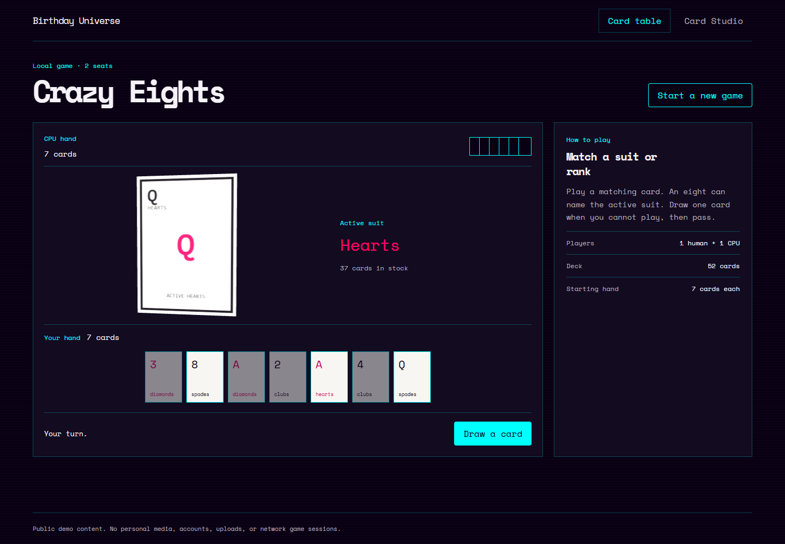
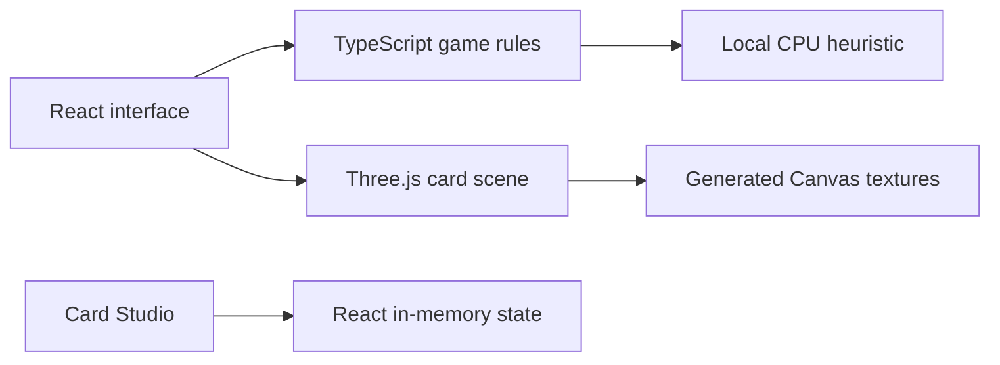

# Birthday Universe Demo

A browser-based Crazy Eights table and card editor built as a safe public showcase. Play against a local CPU opponent, inspect a procedural Three.js card, or edit fictional card text. The demo uses no personal media or relationship data.



## What works

| Feature | Status | Evidence |
| --- | --- | --- |
| Two-seat Crazy Eights rules | TESTED | `src/game/rules.test.ts` |
| Local CPU opponent | TESTED | `src/game/rules.test.ts` |
| Procedural 3D card renderer | TESTED | `tests/app.spec.ts` |
| Fictional card editor | TESTED | `tests/app.spec.ts` |
| Canvas word search and jigsaw | PLANNED | Not included in this edition |
| Network multiplayer, printing, and export | PLANNED | Not included in this edition |

The CPU uses a small legal-move heuristic; it is not a competitive strategy engine. If the stock and recyclable discard cards are exhausted, the game ends in a stalemate.

## Stack and architecture

- React and TypeScript provide the interface and in-memory UI state.
- Three.js renders the top card from browser-generated Canvas textures and simple geometry.
- The game engine is a standalone, browser-compatible implementation of generic Crazy Eights rules; it has no personal records or asset dependencies.
- There is no backend, account system, network multiplayer, file upload, analytics, or persistent storage.
- Space Mono is bundled locally from `@fontsource/space-mono`; no remote font or image request is needed.



## Run locally

Prerequisites: Node.js 22 or newer and npm.

```powershell
npm ci
npm run dev
```

Vite prints the local development URL. To create and serve a production build:

```powershell
npm run build
npm run preview
```

Run the unit tests with `npm test`. Browser tests use Playwright; install its Chromium build with `npx playwright install chromium` when no compatible browser is already available, then run `npm run test:e2e`.

See the [test matrix](docs/TEST_MATRIX.md), [known limitations](docs/KNOWN_ISSUES.md), and [static deployment notes](docs/DEPLOYMENT.md).

## Privacy and content

All game state and editor text stay in browser memory and disappear on reload. The editor does not submit a form. This edition contains no photographs, recordings, private documents, personal messages, original archives, secrets, or private-data fixtures. See [the security notes](docs/SECURITY.md).

## Limits

This is a local browser demo, not a production game service. It has no online play, login, persistence, printing/export flow, word search, or jigsaw. WebGL support is required for the 3D preview; the 2D controls remain available if renderer setup fails. Mobile and desktop layout are checked in Playwright, but no broad browser certification is claimed.

## Credits and licensing

Third-party packages and their licenses are listed in [the notices](docs/THIRD_PARTY_NOTICES.md). No repository-wide license has been selected. Do not assume permission to reuse this project's code until a project license is approved.
